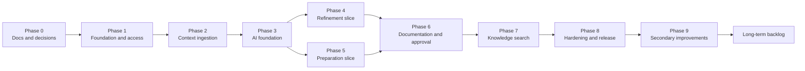

# HINTERLAND — Implementation Plan

**Document status:** Approved delivery sequence for the MVP  
**Version:** 1.3 — records the Supabase-backed implementation  
**Last updated:** 2026-11-09  
**Current state:** The public website, 3D scroll experience, and authenticated `/app` workspace are implemented. Supabase Auth, Postgres with row-level security, private storage, uploads, browser extraction and OCR, pasted context, source labels, full-text search, knowledge records, and account deletion are live against the configured project. AI routes are implemented server-side and activate when provider credentials are configured. Section 2.1 is retained as the historical frontend milestone that preceded the backend.

---

## 1. Purpose

This plan defines the ordered path from an empty repository to an MVP that satisfies [PRODUCT_SPEC.md](./PRODUCT_SPEC.md) and the release gate in [PRIVACY_AND_RELIABILITY.md](./PRIVACY_AND_RELIABILITY.md).

It is a sequence of vertical slices, not a waterfall. Each phase produces working, testable behavior and leaves the application in a coherent state.

Sizes are relative, not calendar commitments:

| Size | Meaning |
| --- | --- |
| S | Small, well-understood scope |
| M | Moderate scope with several dependencies |
| L | Large scope with integration risk and significant testing |

---

## 2. Build principles

1. **Privacy and approval are foundational, not hardening.** RLS, owner scoping, and the approval state machine are built in the first phases where they apply.
2. **One vertical slice at a time.** Each AI feature ships with its review interface, evidence panel, and failure states before the next begins.
3. **No ungrounded output path.** The evidence validator and grounding policy exist before the first user-facing generation.
4. **Real fixtures, not demos.** Testing uses representative agendas, notes, transcripts, and documents, including adversarial cases.
5. **No invented integrations.** Only Supabase, an LLM API, and server-side extraction are introduced. No Google Drive, audio, or team features.
6. **The interface is part of the product.** A feature is not done until its empty, loading, error, review, and approved states exist.
7. **Every phase has an exit criterion.** Work does not proceed on a "mostly done" basis.

---

## 2.1 Implemented frontend milestone — interactive demo workspace

**Status:** historical. The frontend-only milestone below was superseded by the Supabase-backed implementation and by removal of all demo content. The table records what that milestone covered; it is not a description of the current build.

| Area | Implementation | Boundary |
| --- | --- | --- |
| Shell | Separate route group and warm-light theme, persistent 256px sidebar, 72px collapsed rail, mobile drawer, breadcrumbs, profile and notification menus, `Ctrl/⌘ K` search | Fixed demo identity; no authentication |
| Overview | Welcome, quick actions, recent projects, meetings, documents, summaries, interactive pending actions | All content is labelled demo data |
| Communication | Full refinement form; refined and alternative copy; clarity improvements; ambiguity warnings; change explanations; edit, copy, save | Deterministic local rules; no model |
| Preparation | Objective, agenda, date, project, document selection, prior notes; overview, talking points, questions, gaps, risks, sequence; copy and save | Deterministic local rules; saved briefs are browser-local knowledge records |
| Intelligence | Notes or consented transcript; summary, discussion, decisions, questions, actions; edit, regenerate, approve, save, export | Approval gates save/copy/export; saved records are browser-local; no invented owner or deadline |
| Projects & documents | Master-detail project context; searchable/filterable library; PDF/DOCX text extraction and preview | Browser-only extraction; 50,000-character cap; no original-file upload, OCR, cloud storage, or AI analysis |
| Knowledge | Repository search and project/type/meeting/topic/date filters; record inspection, related-record navigation, copy, project link | Demo seed records plus user-saved browser-local records |
| Development | Tone, structure, greeting, sign-off, preservation boundary; approved examples; suggestions; feedback history | Preferences and examples are user-approved; no automatic learning |
| Settings & help | Demo identity, notification preferences, reset flow, FAQ, shortcuts, demo boundaries | No account, billing, or team features |
| Responsiveness | Desktop persistent sidebar, tablet collapse, mobile drawer and stacked forms | Verified at 1440, 1024, 768, and 390 widths |

Shared workspace primitives live in `src/components/app/` (shell, navigation config, search, toast, cards, fields, tabs, modal, empty state, copy button). Each feature has its own route and component folder. Refinement and extraction rules live in `src/lib/demo-refine.ts` and `src/lib/demo-extract.ts`, separate from presentation.

**Validation:** `npm run typecheck`, `npm run lint`, `npm run build`, plus browser checks for navigation, search, forms, loading states, editing, approval gating, upload validation, filters, copy, save, export, modal keyboard behaviour, and mobile layout.

---

## 3. Roadmap overview

### 3.1 Milestones

| Milestone | End of phase | Demonstrable outcome |
| --- | --- | --- |
| M0 | Phase 0 | Approved documentation and resolved blocking decisions |
| M1 | Phase 1 | A user can sign in, create a project, and see only their own data |
| M2 | Phase 2 | A user can add PDF, DOCX, and pasted sources and see extracted text |
| M3 | Phase 3 | A validated, evidence-checked AI generation runs end to end on fixtures |
| M4 | Phase 4 | A user can refine a draft with intention and audience alternatives |
| M5 | Phase 5 | A user can generate and approve a meeting preparation brief |
| M6 | Phase 6 | A user can extract, review, approve, and save a meeting record |
| M7 | Phase 7 | A user can find approved records by keyword and filters |
| M8 | Phase 8 | The MVP passes privacy, reliability, accessibility, and release gates |
| M9 | Phase 9 | Secondary improvements ship in priority order |

---

## 4. Phase 0 — Documentation and decisions

**Size:** S  
**Dependencies:** None  
**Status:** Complete

### Scope

- Author the eight permanent documents in `docs/`.
- Establish the feature matrix and MVP boundaries.
- Define the architecture, data model, approval model, and evidence rules.
- Define the design system using the specified brand palette and typography.
- Record open decisions and defaults.

### Deliverables

- `docs/PRODUCT_SPEC.md`
- `docs/FEATURE_MATRIX.md`
- `docs/USER_FLOWS.md`
- `docs/TECHNICAL_ARCHITECTURE.md`
- `docs/DESIGN_SYSTEM.md`
- `docs/PRIVACY_AND_RELIABILITY.md`
- `docs/IMPLEMENTATION_PLAN.md`
- `docs/ASSET_CREDITS.md`

### Exit criteria

- Documentation is internally consistent.
- The user approves the architecture and plan.
- The following are resolved or explicitly defaulted:
  - Supabase environment and access.
  - LLM provider, model, and data-handling configuration.
  - Authentication method.
  - Deployment target.
  - Initial upload, page, and context limits.
- No application code has been written before approval.

### Risks

- Ambiguity in provider data terms delays Phase 3. Mitigation: select the provider early and review terms before building the adapter.

---

## 5. Phase 1 — Foundation, authentication, and projects

**Size:** M  
**Dependencies:** Phase 0 approval

### Scope

- Initialize the Next.js application with TypeScript strict mode.
- Add the design token layer, fonts, base typography, and app shell.
- Configure Supabase Auth and cookie-based sessions.
- Create the `profiles` and `projects` tables with RLS.
- Implement project creation, listing, rename, archive, and delete.
- Build the landing and authentication screens.
- Establish CI: lint, typecheck, unit tests, and a first RLS integration test.
- Add environment validation and a documented local setup.

### Deliverables

- Running application shell with brand typography and palette.
- Sign-up, sign-in, sign-out, and protected routes.
- Projects index and project workspace overview.
- Initial migration and generated database types.
- Two-user isolation test for `projects`.

### Exit criteria

- An unauthenticated visitor cannot access application routes.
- A signed-in user can create, rename, archive, and delete a project.
- A second user cannot read, update, or delete the first user's project by ID or API.
- The design tokens render correctly at 320px, 768px, and 1280px.
- CI passes from a clean checkout.
- No service-role key is present in client bundles.

### Testing

- Unit: validation schemas, authorization helpers.
- Integration: RLS for `profiles` and `projects`.
- E2E: sign up, create project, sign out, sign in, open project.

### Risks

- Auth cookie handling in server components. Mitigation: follow the supported Supabase SSR pattern and test session refresh.
- RLS policy mistakes. Mitigation: two-user tests from the first migration.

---

## 6. Phase 2 — Context ingestion

**Size:** L  
**Dependencies:** Phase 1

### Scope

- Create private Supabase Storage bucket and owner-path policies.
- Implement PDF and DOCX upload with file validation and limits.
- Implement pasted text sources.
- Extract text, preserve page/paragraph offsets, and chunk content.
- Store documents, extracted text, and chunks with owner-scoped RLS.
- Build the source library, source type labels, statuses, and read-only text view.
- Implement source deletion, including derived text and chunks.
- Handle image-only, password-protected, malformed, and oversized files explicitly.

### Deliverables

- Upload and paste flows.
- Extraction status model: `pending`, `processing`, `ready`, `no_text`, `image_only`, `failed`.
- Document chunks with source locations.
- Source library and viewer.
- Storage and document isolation tests.

### Exit criteria

- A text-based PDF produces readable extracted text with page references.
- A DOCX produces readable text in document order.
- Pasted notes save and display correctly.
- An image-only PDF shows an OCR-not-supported state, not a success.
- A second user cannot list, open, download, or delete the source.
- Deleting a source removes its file, text, and chunks.
- No public file URL exists.

### Testing

- Integration: upload, extraction, deletion, storage policies, two-user isolation.
- Unit: chunk boundaries, offset preservation, file type validation.
- E2E: add PDF, add DOCX, paste notes, open extracted text, delete source.

### Risks

- PDF extraction quality varies. Mitigation: test a representative corpus early; document limitations.
- Serverless timeout on large files. Mitigation: page and size caps; clear failure states.
- Parser vulnerabilities. Mitigation: pinned, audited libraries; no remote fetching; no execution.

---

## 7. Phase 3 — AI foundation

**Size:** L  
**Dependencies:** Phase 2; provider selected

### Scope

- Implement the provider adapter interface and one concrete adapter.
- Add validated environment configuration and provider timeouts.
- Build the context assembler with explicit source selection and a token budget.
- Create versioned prompt templates for refinement, preparation, and documentation.
- Define Zod schemas for each task output.
- Implement schema validation with one repair attempt.
- Implement evidence normalization and server-side quote validation.
- Implement grounding policy for decisions, owners, and deadlines.
- Add `ai_runs` metadata, rate limits, and failure codes.
- Build an evaluation fixture set and a runner.
- Expose no user-facing feature yet beyond an internal test harness.

### Deliverables

- Provider adapter and orchestrator.
- Context packet with inclusion manifest.
- Evidence validator with unit tests.
- Grounding policy with unit tests.
- Task schemas and prompt versions.
- AI run logging and per-user quotas.
- Evaluation fixtures and report.

### Exit criteria

- A fixture-based generation returns schema-valid output.
- A fabricated evidence quote fails validation.
- An unsupported owner or deadline is blanked and flagged.
- A relative deadline is preserved and marked for confirmation.
- Prompt-injection fixtures do not alter system behavior.
- A provider timeout or malformed response produces a clear failure, not a draft.
- No cross-project context appears in a packet.
- The evaluation report shows zero invented owners or deadlines.

### Testing

- Unit: schemas, evidence normalization, grounding, context budget.
- Integration: rate limits, AI run persistence.
- Evaluation: golden and adversarial fixtures.

### Risks

- Provider structured output is inconsistent. Mitigation: strict schema validation and a single repair attempt; no free-form fallback.
- Prompt injection. Mitigation: untrusted-data framing, no tools, adversarial fixtures.
- Evidence strings differ by whitespace or Unicode. Mitigation: normalization rules with tests.

---

## 8. Phase 4 — Communication refinement

**Size:** M  
**Dependencies:** Phase 3

### Scope

- Build the refinement screen with original draft, stated intention, audience, and source selection.
- Implement streaming generation for refined text and audience variants.
- Display ambiguity findings, change explanations, and unsupported-claim warnings.
- Build the evidence panel for project facts used.
- Add copy and approve actions; approval stores the original alongside the selected variant.
- Add empty, loading, partial, failure, and approved states.
- Add `refinement_sessions` and `refinement_variants` tables with RLS.

### Deliverables

- Complete refinement vertical slice.
- Variant comparison and approval.
- Evidence and ambiguity presentation.
- Refinement fixtures and E2E coverage.

### Exit criteria

- A user can enter a draft, intention, and audience and receive a refined version plus at least one alternative.
- The original and intention remain visible.
- Ambiguities and change explanations are shown.
- Unsupported project facts are flagged, not inserted.
- No artifact is published to knowledge automatically.
- A second user cannot access the session or variant.
- Generation failure preserves the user's input and shows a retry.

### Testing

- E2E: draft → refine → inspect evidence → copy → approve.
- Integration: variant approval and isolation.
- Evaluation: intent-preservation fixtures, ambiguity cases, unsupported facts.

### Risks

- Users may interpret stylistic changes as meaning changes. Mitigation: explicit change explanations and side-by-side intent.

---

## 9. Phase 5 — Meeting preparation

**Size:** M  
**Dependencies:** Phase 3; Phase 1 meetings model

### Scope

- Create meetings with title, date, agenda link, and supplied attendee text.
- Build the preparation screen with user goal and source selection.
- Generate talking points, questions, gaps, risks, and contribution sequence.
- Show grounding status per item.
- Implement review, edit, reorder, remove, and approval.
- Add `meetings` and `preparation_briefs` tables with RLS.
- Save approved preparation briefs to the meeting. In the MVP, preparation briefs are not published to the knowledge repository.

### Deliverables

- Meeting creation and preparation vertical slice.
- Approved preparation briefs with evidence and inclusion manifest.
- Preparation fixtures and E2E coverage.

### Exit criteria

- A user can generate a brief from an agenda and previous notes.
- Each item is grounded or explicitly labeled as a suggestion.
- A conflict between the agenda and prior notes is surfaced, not resolved silently.
- Approval saves the brief to the meeting and does not create a knowledge entry.
- A second user cannot access the meeting or brief.
- Unapproved briefs do not appear in search.

### Testing

- E2E: create meeting → select sources → generate → review → approve → see the approved brief on the meeting.
- Integration: meeting ownership and brief approval.
- Evaluation: insufficient context, conflicting sources, absent attendees.

### Risks

- Briefs become generic when context is thin. Mitigation: visible grounding labels and a clear insufficient-context state.

---

## 10. Phase 6 — Meeting documentation and approval

**Size:** L  
**Dependencies:** Phases 3 and 5

### Scope

- Build meeting notes/transcript input and the extraction request.
- Generate summary, discussion points, decisions, open questions, and action items.
- Build the review workspace with item editing, reclassification, merging, and removal.
- Implement evidence validation display and unresolved-item blocking.
- Enforce explicit-only owners and deadlines, including relative-date handling.
- Implement the transactional approval RPC.
- Store immutable approved records, versions, knowledge records, and audit events.
- Build record detail with approval metadata.
- Implement record deletion.

### Deliverables

- End-to-end documentation and approval flow.
- `meeting_records`, `record_items`, `knowledge_records`, and `audit_events` tables with RLS.
- Approval idempotency and concurrency handling.
- Documentation fixtures and E2E coverage.

### Exit criteria

- Pasted notes produce a structured record with summary, points, decisions, questions, and actions.
- Every owner and deadline is evidence-backed or "Not specified."
- A decision without evidence blocks approval until resolved.
- A relative date is preserved and marked "Needs confirmation," not resolved.
- A proposal is not recorded as a decision.
- Approval is atomic, idempotent, and audited.
- The approved record is immutable; a revision creates a new version.
- A second user cannot read, edit, approve, or delete the record.
- No generation path writes to knowledge directly.

### Testing

- Integration: approval transaction, idempotency, version conflict, isolation, audit.
- Unit: grounding policy, relative dates, conflict detection.
- E2E: paste notes → extract → resolve items → approve → open record.
- Evaluation: proposals, conflicts, unnamed speakers, missing owners/dates, prompt injection.

### Risks

- Over-extraction of decisions. Mitigation: conservative prompts, evidence requirement, user reclassification.
- Approval race conditions. Mitigation: row lock, expected version, idempotency key.
- Long transcripts exceed context. Mitigation: chunked extraction with an inclusion manifest and explicit incompleteness.

---

## 11. Phase 7 — Knowledge repository and search

**Size:** M  
**Dependencies:** Phase 6

### Scope

- Build the knowledge page with approved meeting records only.
- Implement PostgreSQL full-text search with `websearch_to_tsquery`.
- Add filters for record type, date range, meeting, and topic.
- Build highlighted snippets, pagination, result detail, and empty states.
- Add topic assignment during approval or record editing.
- Ensure drafts, discarded, and superseded records are excluded.
- Add search isolation and scope tests.

### Deliverables

- Searchable knowledge repository.
- Filter and browse experience.
- Search tests, including cross-user isolation and draft exclusion.

### Exit criteria

- An approved record is findable by title and body keyword.
- Filters by type, date, and topic work together.
- A draft never appears in results.
- A second user cannot retrieve a record by search, URL, or API.
- Deleted sources show "Deleted" in evidence without breaking the record.
- Empty and no-result states guide the next action.

### Testing

- Integration: search scope, RLS, draft exclusion.
- E2E: approve → search → filter → open record → inspect evidence.
- Unit: query normalization and snippet generation.

### Risks

- English stemming limitation for non-English content. Mitigation: disclose; evaluate a language-aware configuration post-MVP.
- Ranked results feel unpredictable. Mitigation: date-descending fallback and clear snippets.

---

## 12. Phase 8 — Hardening and release readiness

**Size:** L  
**Dependencies:** Phases 1–7

### Scope

- Complete the two-user RLS and storage isolation suite for every table.
- Add end-to-end coverage for all five MVP capabilities.
- Complete accessibility testing and fixes for core flows.
- Audit and complete all empty, loading, error, and deletion states.
- Verify rate limits, timeouts, quotas, and cost controls.
- Add structured logging, metrics, and security alerts.
- Run the full AI evaluation suite and human spot review.
- Verify deletion end to end, including storage and search indexes.
- Configure backups and run a restore drill.
- Finalize privacy notice, terms, subprocessor list, and retention windows.
- Verify no fabricated marketing claims or nonexistent features.
- Document known limitations in the interface where relevant.

### Deliverables

- Release candidate.
- Test evidence for every privacy control.
- Operational runbook and incident contacts.
- Privacy and terms documents.
- Approved evaluation report.

### Exit criteria

- All release gates in [PRIVACY_AND_RELIABILITY.md](./PRIVACY_AND_RELIABILITY.md) pass.
- Zero confirmed cross-account access in tests.
- Zero invented owners or deadlines in evaluation fixtures.
- Approval cannot be bypassed.
- Deletion removes files, text, chunks, records, and index entries.
- Core flows meet WCAG 2.2 AA expectations.
- Restore drill passes.
- Privacy notice and terms are published.
- Known limitations are disclosed.

### Testing

- Full regression suite.
- Security-focused review of authorization, storage, and logging.
- Manual accessibility and responsive review.
- Restore drill.
- Cost and rate-limit simulation.

### Risks

- Late discovery of an architectural privacy flaw. Mitigation: isolation testing starts in Phase 1 and runs on every migration.
- Provider data terms change. Mitigation: re-review before launch and on configuration change.
- Accessibility gaps in complex review panes. Mitigation: build the linear reading order and keyboard model in Phase 4, not Phase 8.

---

## 13. Phase 9 — Secondary improvements

**Size:** M per item  
**Dependencies:** MVP release

Sequence by user value and architectural reuse:

| Order | Improvement | Depends on | Why this order |
| --- | --- | --- | --- |
| 9A | Professional meeting minutes template | Phase 6 | Reuses approved records; low new risk |
| 9B | Follow-up document drafting | Phase 4, Phase 6 | Reuses refinement and record approval |
| 9C | Record export (Markdown first) | Phase 7 | Reuses approved records and provenance |
| 9D | Document intelligence workspace | Phase 3 | Uses the AI foundation and source viewer |
| 9E | Document-to-project connections | 9D, Phase 7 | Requires stable document analysis |
| 9F | Explicit feedback and style examples | Phase 4 | Minimal personalization foundation |
| 9G | Basic style profile | 9F | Requires enough approved examples |
| 9H | Related knowledge suggestions | Phase 7 | Requires retrieval evaluation |
| 9I | Record version diff | Phase 6 | Reuses versioned records |
| 9J | Copy-ready channel formatting | Phase 4 | Refinement add-on |

Each secondary item requires its own short specification, privacy review if it changes data handling, and exit criteria before implementation.

---

## 14. Long-term backlog

Not designed, estimated, or scheduled:

- Audio recording with consent.
- Live meeting assistance.
- Advanced personalization and coaching.
- Google Drive and other cloud-drive integrations.
- Semantic search.
- Team workspaces and sharing.
- Organization-wide integrations, SSO, and administration.
- Real-time collaboration.
- Enterprise retention and compliance controls.
- Organization-specific workflows.
- Multi-client consultant patterns.

These are captured in [FEATURE_MATRIX.md](./FEATURE_MATRIX.md) and are not part of the MVP plan.

---

## 15. Definition of done

A feature is done only when:

- [ ] It matches the feature matrix and product specification.
- [ ] Input validation exists at the server boundary.
- [ ] Ownership is enforced in the application and by RLS.
- [ ] Generated content has evidence handling or explicitly marks its absence.
- [ ] Draft, review, approved, and error states exist.
- [ ] Empty, loading, and failure states have useful copy.
- [ ] Keyboard and screen-reader paths work.
- [ ] Tests cover the happy path and the important failure modes.
- [ ] No content appears in logs.
- [ ] No feature is claimed that does not exist.
- [ ] Documentation is updated if behavior or scope changed.

---

## 16. Test strategy

| Layer | Tooling | Scope |
| --- | --- | --- |
| Unit | Vitest | Schemas, grounding, evidence normalization, chunking, query building, state transitions |
| Integration | Vitest against local Supabase; SQL assertions | RLS, storage policies, approval transactions, idempotency, deletion |
| End-to-end | Playwright | Sign-in, project creation, ingestion, refinement, preparation, documentation, approval, search |
| AI evaluation | Fixture runner | Grounding, invented commitments, prompt injection, conflict handling, insufficient context |
| Accessibility | Automated checks plus manual keyboard and screen-reader review | Core flows and component states |
| Security | Code review, dependency audit, authorization tests | Secrets, storage, RLS, injection, rate limits |
| Recovery | Manual drill | Backup restore and deletion verification |

### 16.1 Required test fixtures

- Text-based PDF with headings and page numbers.
- DOCX with paragraphs, lists, and a table.
- Image-only PDF.
- Agenda.
- Previous meeting notes with a prior decision.
- Transcript with decisions, proposals, open debate, owners, missing owners, explicit dates, relative dates, and conflicts.
- Prompt-injection document.
- Ambiguous draft.
- Insufficient-context inputs.
- Two-user isolation dataset.

Fixtures must be synthetic or properly anonymized. No real client data.

---

## 17. Risk register

| Risk | Likelihood | Impact | Mitigation | Trigger |
| --- | --- | --- | --- | --- |
| Cross-tenant data exposure | Low | Critical | RLS, composite keys, two-user tests, server checks | Any isolation test failure blocks release |
| Model invents owners or deadlines | Medium | High | Evidence validation, grounding policy, approval block, fixtures | Any fixture failure blocks AI release |
| Poor extraction on real PDFs | Medium | High | Corpus testing early, clear failure states, documented limits | More than a small share of representative PDFs fail |
| Prompt injection changes behavior | Medium | High | Untrusted framing, no tools, adversarial tests | Any injection fixture influences output policy |
| Provider terms or availability change | Medium | High | Provider abstraction, due diligence, monitoring | Provider notice or outage |
| Long generation latency | Medium | Medium | Streaming, timeouts, budgets, progress copy | p95 latency makes review impractical |
| Context budget truncation hides information | Medium | Medium | Inclusion manifest, visible exclusions | Any silent truncation |
| Approval race or duplicate | Low | High | Transaction, row lock, version, idempotency | Any duplicate record |
| Accessibility gaps in review UI | Medium | Medium | Build accessible structure early, manual testing | Blocking keyboard path |
| Scope creep from secondary features | High | Medium | Feature matrix change control | Any unplanned feature in MVP branch |
| Cost overrun from AI usage | Medium | Medium | Quotas, budgets, monitoring | Usage exceeds forecast |
| Deletion leaves derived data | Low | High | Cascades, chunk cleanup, storage deletion, tests | Any residual data after deletion |
| Backup restore fails | Low | High | Drill before launch | Drill failure blocks release |

---

## 18. Decisions required before implementation

| # | Decision | Needed by | Default if no decision |
| --- | --- | --- | --- |
| D1 | Supabase project and credentials | Phase 1 | Local Supabase only; no production project |
| D2 | Authentication method | Phase 1 | Email and password |
| D3 | Deployment target | Phase 1 | Deployment-agnostic Node host |
| D4 | LLM provider and model | Phase 3 | Build adapter; generation blocked until configured |
| D5 | Provider training and retention settings | Phase 3 | Provider not used for user content until verified |
| D6 | Upload, page, paste, and context limits | Phase 2–3 | 20 MB, 200 pages, 200,000 characters |
| D7 | Log and backup retention windows | Phase 8 | Must be set before launch; no implicit default |
| D8 | Export format priority | Phase 9 | Markdown first |
| D9 | Privacy notice and terms owner | Phase 8 | Product and legal review required before launch |

---

## 19. Environment and repository checklist

Before Phase 1:

- [ ] Node.js LTS available.
- [ ] Package manager selected and lockfile committed.
- [ ] Supabase CLI installed.
- [ ] Local Supabase running.
- [ ] `.env.example` documents every required variable.
- [ ] No secrets committed.
- [ ] Repository initialized and branch protections defined if collaboration begins.
- [ ] CI workflow defined for lint, typecheck, unit, and integration tests.
- [ ] Synthetic fixtures directory created.
- [ ] Fonts and licenses recorded in [ASSET_CREDITS.md](./ASSET_CREDITS.md).

---

## 20. Scope control

- The MVP is the five capabilities in [PRODUCT_SPEC.md](./PRODUCT_SPEC.md) and the core rows in [FEATURE_MATRIX.md](./FEATURE_MATRIX.md).
- A secondary improvement enters the MVP only with a documented scope change, a dependency check, and revised exit criteria.
- A new integration is not added without a product specification, privacy review, and asset/processor documentation.
- If a phase cannot meet its exit criteria, the phase does not close; scope is reduced instead of shipping an unverified control.
- Privacy, approval, and evidence requirements cannot be traded for speed.

---

## 21. MVP completion statement

The MVP is complete when a single user can:

1. Sign in and create a project with objectives.
2. Add a PDF, a DOCX, an agenda, and previous notes.
3. Generate and approve a meeting preparation brief grounded in those sources.
4. Refine a draft with stated intention and audience alternatives.
5. Paste meeting notes and obtain a structured, evidence-backed record.
6. See explicitly which decisions, owners, and deadlines are confirmed or unspecified.
7. Approve the record and find it later through keyword search and filters.
8. Delete any source, record, project, or account data.
9. Be unable to access any other user's content, and unable to have their content accessed.

No capability outside this list is required for MVP acceptance.

---

## 22. Implementation status — design foundation, public website, and 3D experience

**Status date:** 2026-11-08

**Completed**

- Next.js 16 App Router project with strict TypeScript, React 19, Tailwind CSS 4.2.4, and shadcn/ui primitives.
- Brand token layer in `src/app/globals.css`, including derived accessible tokens (`--accent-ink`, `--input`/`--border-strong`) and the shadcn variable contract.
- Newsreader and DM Sans through `next/font/google`; Lucide icons at 1.5 stroke width.
- Shared components: site header with active-section tracking and mobile sheet, footer, buttons, section headings, feature and editorial cards, badges, tabs, dialog, tooltip, form fields, loading, empty, and error states.
- Complete public website at `/`: hero, problem, solution, six distinct feature compositions, five-step workflow, interactive product previews (refinement, preparation, summary, document findings, knowledge search), principles, audiences, technology and trust, roadmap, and closing.
- Public navigation, hero, closing, and footer actions enter the interactive `/app` workspace. The legacy `/workspace` URL redirects there rather than opening a separate static mockup.
- Responsive layouts verified at 1440px and 390px; keyboard and reduced-motion behavior; local-only sample knowledge search.
- Contrast review against WCAG 2.2 AA. Low-opacity metadata was raised to at least 70% Ivory on the dark site, and small gold-family text uses `--accent-ink` (`#D8B878`). Terracotta remains the brand accent for borders, rules, and large display numerals. The workspace uses the original light palette with Forest Green and Charcoal Ink for text.
- The fixed paper-grain overlay uses normal blending at 4.5% opacity (`--paper-opacity: 0.045`). `mix-blend-mode: multiply` was removed after it produced duplicated band artifacts during surface screenshots; the texture remains non-animated and token-controlled.
- Interactive 3D scroll experience at `#experience`: one pinned section, six synchronized stages, GSAP ScrollTrigger progress, camera keys, procedural floating documents, a terracotta/gold context thread, real CC0 models, pointer parallax, floating stage copy, and a drawer opening in the final stage.
- Local 3D assets: Drawer Cabinet, Binder Notebook, and Office Notepads from Poly Haven (CC0 1.0), packed as GLB. Sources, licenses, direct download URLs, and byte sizes are recorded in [ASSET_CREDITS.md](./ASSET_CREDITS.md).
- Responsive and failure paths for the 3D section: static six-stage sequence below 1024px, with reduced motion, or when WebGL is unavailable; loading progress; WebGL error boundary; offscreen frame-loop pausing; no runtime third-party requests.
- Documentation updated: README, design-system tokens, and this status section.

**Verification**

| Check | Result |
| --- | --- |
| `npm run typecheck` | Pass |
| `npm run lint` | Pass |
| `npm run build` | Pass; public site and workspace prerendered |
| Development server | Starts and serves `/`, `/app`, and `/workspace` (redirects to `/app`) |
| Desktop inspection | 1440px, all required sections present |
| Mobile inspection | 390px, no horizontal overflow; tabs wrap |
| 3D stages | All six stages verified forward and backward; pinned surface stays at the viewport top for the full timeline |
| 3D console/network | No page exceptions, console errors, failed requests, or HTTP errors on a cache-disabled load |
| 3D readability | Copy column and canvas never overlap at 1440px; stage text remains readable without the canvas |
| Fallbacks | 390px mobile, reduced motion, and disabled-WebGL runs show the static sequence; canvas is not mounted |
| Console | No application exceptions |

**Not implemented in this phase**

- Authentication, database, storage, document extraction, and AI calls.
- Server-enforced data isolation and approval persistence.
- Live meeting recording or transcription.

Backend phases in this plan remain the source of truth for production behavior. The website does not claim that any unimplemented capability is available.

---

## 23. 3D scroll experience — implementation record

**Status date:** 2026-11-08  
**Scope:** Presentation layer only. It visualizes the product story and is not a live product surface.

### 23.1 Architecture

| File | Responsibility |
| --- | --- |
| `src/components/3d/experience-section.tsx` | Pinned section, responsive gating, stage copy, progress rail, live region |
| `src/hooks/use-scroll-progress.ts` | GSAP registration, `matchMedia`, ScrollTrigger pin, progress ref, stage state, cleanup |
| `src/components/3d/scene-canvas.tsx` | WebGL feature check, error boundary, loader, font-readiness context |
| `src/components/3d/hinterland-scene.tsx` | Canvas, lighting, environment, camera sampling and damping |
| `src/components/3d/scene-objects.tsx` | Object keyframes, sampling, damping, floating drift, pointer parallax |
| `src/components/3d/desk-model.tsx` | Procedural desk, floor, mat, lamp, pen |
| `src/components/3d/model-object.tsx` | `useGLTF`, normalization, model placement, drawer motion |
| `src/components/3d/document-card.tsx` | Paper object with generated front texture |
| `src/components/3d/canvas-textures.ts` | Sample message, project, calendar, notes, record typography |
| `src/components/3d/thread.tsx` | Terracotta/gold curve growth and anchor knots |
| `src/components/3d/static-story.tsx` | Accessible six-stage fallback |
| `src/components/3d/story-data.ts` | Stage copy and identifiers |

### 23.2 Runtime behavior

- The section is one `600vh` wrapper. ScrollTrigger pins its `h-svh` child with `pinSpacing: false` and `anticipatePin`.
- Scroll progress is written to a mutable ref. React state updates only when the rounded stage index changes (six times).
- Each object has six keyframes; position, rotation, and scale are smoothstep-interpolated, then damped per frame. The camera follows six authored keys with pointer influence.
- The thread grows between stages 5 and 6 with `setDrawRange`; anchor knots fade and pulse.
- The scene is mounted only for `(min-width: 1024px) and (prefers-reduced-motion: no-preference)` and only if WebGL support is detected.
- `frameloop` switches to `demand` when the wrapper is offscreen. DPR is capped at 1.6.
- All GSAP triggers and listeners are reverted on unmount; no global scroll hijacking or smooth-scroll library is used.

### 23.3 Dependencies and confirmed versions

`three@0.187.0`, `@react-three/fiber@9.8.2`, `@react-three/drei@10.7.9`, `gsap@3.15.1`, and dev `@types/three@0.187.0`. React 19 compatibility was checked before installation.

### 23.4 Asset decision record

- **Imported:** three CC0 Poly Haven models, downloaded as 1k GLTF packages and packed to GLB with `gltf-transform copy`.
- **Procedural:** desk, floor, leather mat, lamp, pen, thread, halos, and all document faces. Document text is synthetic sample content.
- **Not imported:** paper sheets, folders, calendars. Stock textures would not carry the required typography, and procedural faces keep the download small.
- **No hotlinking:** model and texture URLs are not referenced at runtime; only local `/models/*.glb` files are fetched.
- **License:** CC0 1.0 verified at polyhaven.com/license; no attribution is required, but creators are credited in [ASSET_CREDITS.md](./ASSET_CREDITS.md).

### 23.5 Known limitations

- The imported models have no animation clips; all movement is procedural. `useAnimations` was therefore not applicable.
- The scene requires WebGL. Software-rendered environments may be slow; the fallback covers failure, not low frame rate.
- The scene is illustrative. It does not read or display real user data.
- Mobile and reduced-motion users receive the static representation by design, not a reduced WebGL scene.

---

## 24. Dark royal theme and site-wide motion — implementation record

**Status date:** 2026-11-08  
**Scope:** Presentation layer only. No product behavior, data handling, or copy claims changed.

### 24.1 Theme

- `src/app/globals.css` `@theme inline` remaps the semantic tokens so the existing utility vocabulary renders a dark theme: `--color-ink` is now the type color `#EFE7D7`, `--color-stone` a raised surface `#16271F`, `--color-forest` a gold accent `#D3B477`, and `--color-paper`/`--color-deep` the page grounds.
- The brand hue set is unchanged. Emerald `#064E3B`, Burgundy `#722F45`, Navy `#172554`, Plum `#5B3A70`, and Gold `#C9A45C` are added strictly as atmosphere tokens.
- `html` owns the page background (`#07130F`), `body` is transparent, and the fixed ambient layer sits at `z-index: -10`. This keeps every section above the same continuous atmosphere without per-section fixed layers.
- `color-scheme: dark` and a thin custom scrollbar complete the surface contract.
- Structural surfaces (paper, deep, emerald, stone, cards, previews, workspace, footer) were patched in place; no light-theme surface remains in the public site.

### 24.2 Ambient and section atmosphere

- `src/components/layout/ambient-field.tsx` renders five `.ambient-blob` elements in emerald, navy, burgundy, plum, and gold.
- `.ambient-blob` uses `filter: blur(80px)`, `mix-blend-mode: screen`, low opacity, and transform-only keyframes at 28–46s.
- `.section-shell` plus `.tone-emerald/burgundy/navy/plum/gold` adds a radial tint, a gold/burgundy hairline, and a diamond mark. This is CSS-only to keep DOM weight low.
- `.hero-shell`, `.hero-orbit`, `.hero-spark`, `.flow-arrow-x/y`, `.thread-dot`, and `.drift-word` provide the small moving editorial details.

### 24.3 Scroll motion

- `src/components/motion/site-motion.tsx` is the single GSAP setup. It awaits `document.fonts.ready`, registers ScrollTrigger, and builds one `gsap.context`.
- Supported attributes: `data-word-reveal` (split words), `data-reveal` (`data-reveal-y`, `data-reveal-delay`), `data-reveal-stagger` (direct children), `data-draw`, and `data-parallax`.
- Word splitting uses a `TreeWalker` over text nodes, skips `[data-no-split]`, and preserves whitespace and inline elements.
- Every tween is `gsap.fromTo` with explicit end values and `clearProps: "transform"`. This was a correctness fix: `gsap.from` captured the hidden pending-state opacity as the end value, leaving text invisible. Hover lifts also depend on the cleared transform.
- All triggers are `once: true`; there is no scroll hijack, no smooth-scroll library, and no per-frame React state.
- Applied across the hero, header progress bar, problem, solution, features, workflow, 3D experience header, product previews, principles, audiences, technology and trust, roadmap, closing, and footer.

### 24.4 Progressive enhancement and reduced motion

- `src/app/layout.tsx` inline head script sets `html[data-motion="pending"]` only when reduced motion is not requested, with a 4-second timeout that falls back to `off`.
- CSS hides reveal targets only under `html[data-motion="pending"]`. With JavaScript disabled the attribute never appears, so all content is visible.
- `SiteMotion` sets `ready` on success and `off` on error or unmount.
- Under `prefers-reduced-motion: reduce`, word splitting, ScrollTriggers, ambient drift, orbit rotation, spark float, and the 3D canvas do not run. Static colour and layout remain.

### 24.5 Verification

| Check | Result |
| --- | --- |
| `npm run typecheck` | Pass |
| `npm run lint` | Pass |
| `npm run build` | Pass; public site and workspace prerendered |
| Desktop motion | 1440px: all reveal targets reach opacity 1, no retained inline transform |
| Tablet motion | 1024px: 140 word spans split, no console errors, no horizontal overflow |
| Mobile | 390px: no horizontal overflow; static 3D sequence; reveals resolve |
| Hover | Preview cards lift 3px and take the gold border after reveal cleanup |
| Header progress | ScaleX tracks scroll position |
| Reduced motion | No word splits, no ScrollTriggers, decorative animation disabled, content fully visible |
| Console | No application exceptions across desktop, tablet, mobile, reduced-motion, and hover runs |
| 3D at tablet | Scene objects visible through stages 01–03 at 1024×768; stage labels advance |

### 24.6 Known limitations

- The ambient field is five large blurred layers. It is intentionally cheap (transform-only), but on very low-end integrated GPUs it remains the most expensive decorative element.
- `mix-blend-mode: screen` is broadly supported but may render slightly differently in older browsers; the fallback is a simpler, dimmer wash rather than missing content.
- Scroll reveals are one-shot. Re-entering a section does not replay the animation, which is deliberate for reading stability.
- All motion is decorative. The page is fully usable and readable with motion disabled.
