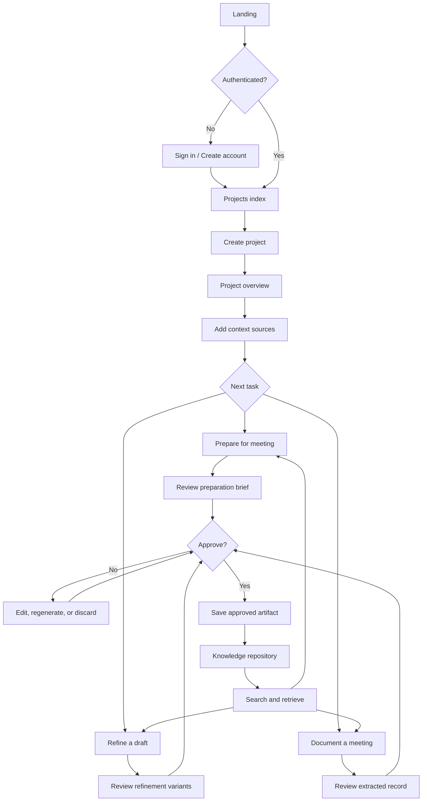
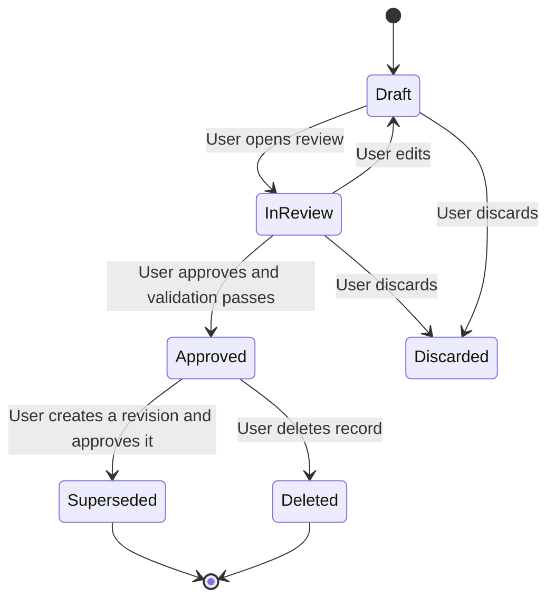

# HINTERLAND — User Flows

**Document status:** Approved interaction model for the MVP  
**Version:** 1.0  
**Last updated:** 2026-11-08  
**Companion documents:** [PRODUCT_SPEC.md](./PRODUCT_SPEC.md), [FEATURE_MATRIX.md](./FEATURE_MATRIX.md), [DESIGN_SYSTEM.md](./DESIGN_SYSTEM.md)

---

## 1. Actors and permissions

| Actor | Description | MVP permissions |
| --- | --- | --- |
| Visitor | Unauthenticated person | View landing page and authentication screens only |
| Owner | Authenticated user who created a project | Create, read, update, delete all content within their own projects |
| AI system | Server-side generation and extraction service | Propose drafts and candidate items; cannot approve, save, delete, or share |

The MVP has no administrator, collaborator, or viewer role. Every authenticated user is the sole owner of their projects. There is no cross-account access path in the product or database.

### 1.1 Flow coverage

This document specifies the MVP flows. Secondary improvements (document intelligence, follow-up documents, export, personalization) and long-term capabilities (recording, live assistance, team workspaces, cloud-drive integrations) require their own flow specifications before implementation. They are not implied to exist by this document.

---

## 2. Information architecture

```
Landing
└── Sign in / Create account
    └── Projects index
        └── Project workspace
            ├── Overview
            ├── Sources        (project documents, agendas, previous notes, transcripts)
            ├── Prepare        (meeting preparation)
            ├── Refine         (communication refinement)
            ├── Meetings       (documentation and approved records)
            └── Knowledge      (approved repository and search)
```

### 2.1 Screen inventory

| Screen | Purpose | Primary action |
| --- | --- | --- |
| Landing | Establish brand and product promise | Start a project |
| Sign in / Create account | Authenticate | Continue to projects |
| Projects index | List and create projects | Open or create a project |
| Project overview | Show objectives, recent sources, upcoming meetings, recent approved records | Add context or start a task |
| Sources | Upload, paste, view, and delete context | Add a source |
| Prepare | Generate and review a preparation brief for a meeting | Approve preparation |
| Refine | Refine a draft with intention and audience | Approve or copy a variant |
| Meetings | Create meetings and review/documented outcomes | Approve a record |
| Meeting record review | Inspect summary, decisions, questions, actions, and evidence; edit items | Approve record |
| Knowledge | Browse and search approved meeting records | Open a record |
| Record detail | Read an approved record with evidence and approval metadata | Copy or export (export is secondary) |
| Account settings | Profile, data deletion, sign out | Delete account data |

### 2.2 Navigation principles

- The project is always visible in the header or sidebar. Context never feels global by accident.
- The active project's tabs are the primary navigation inside the workspace.
- Generation screens show a persistent source tray: what context is being used, and what is excluded.
- Approval state is always visible on a record; a draft never looks approved.
- No destructive action is available without an explicit confirmation that names the affected records.

---

## 3. Flow map



The loop is deliberate: approved knowledge becomes context for the next preparation, refinement, or documentation task in the same project.

---

## 4. Flow 1 — Create a project and add context

**Goal:** Establish the project container and the context required for useful assistance.  
**Entry point:** Projects index → "New project."  
**Persona example:** A startup team member starting a product review project.

### 4.1 Happy path

1. User selects **New project**.
2. User enters a project name and optional description.
3. User adds one or more objectives. Objectives are free text and may be left empty, but the interface recommends at least one because preparation and refinement quality depend on it.
4. System creates the project, scoped to the signed-in owner, and opens the overview.
5. The overview presents a short setup checklist: add a document, add an agenda, add previous notes.
6. User opens **Sources**.
7. User chooses **Upload file** or **Paste text**.
8. For a file, the user selects a PDF or DOCX and confirms the source type.
9. System uploads the file to private storage and begins text extraction.
10. The source row displays `Uploading`, then `Extracting`, then `Ready`.
11. For pasted text, the user enters a title, selects a source type, pastes content, and saves.
12. The source appears in the library with title, type, date, character count, and extraction status.
13. User can open the source to read the extracted text and verify it is complete.

### 4.2 Required states

| State | Interface behavior |
| --- | --- |
| Uploading | Progress indicator with cancel; no false completion |
| Extracting | Status row with elapsed indication; other app areas remain usable |
| Ready | Text preview available; source selectable for generation |
| Empty text | Marked "No usable text found"; source is not silently treated as ready |
| Scanned PDF | Marked "Image-only PDF — OCR is not supported"; user can delete or replace it |
| Extraction failed | Error with retry and delete actions; error reason recorded |
| Unsupported file | Rejected before upload with accepted formats stated |

### 4.3 Validation and edge cases

- Files larger than the configured limit are rejected before upload.
- Password-protected PDFs fail with a clear message.
- A DOCX with only images yields "No usable text found."
- Duplicate uploads are allowed but flagged as a possible duplicate by filename and size. The system does not silently merge them.
- Pasted content over the configured limit is rejected with the limit shown.
- A network failure during upload leaves no partial source marked ready.
- If the user navigates away during extraction, the source continues processing and the status is correct on return.

### 4.4 Success condition

The project contains at least one ready source, and the user can identify what that source is and what type of context it provides.

---

## 5. Flow 2 — Prepare for a meeting

**Goal:** Produce a reviewable preparation brief grounded in project context.  
**Entry point:** Project → Prepare, or Project → Meetings → New meeting.  
**Persona example:** A corporate manager preparing for a cross-functional review.

### 5.1 Happy path

1. User selects **Prepare**.
2. User creates or selects a meeting: title, date, optional supplied attendee list, optional agenda source.
3. User states their goal for the meeting in one or two sentences (optional but recommended).
4. User selects context sources: agenda, previous notes, project documents, and approved meeting records.
5. The source tray displays selected sources, approximate context size, and any excluded sources.
6. User selects **Generate preparation**.
7. System assembles a project-scoped context packet, sends it to the AI service, and streams or returns a structured brief.
8. The brief is presented in four sections: talking points, questions, gaps and risks, and contribution sequence.
9. Each item shows an evidence reference or a "Suggestion — not grounded in selected sources" label.
10. The user edits, removes, reorders, or regenerates individual sections.
11. The user selects **Approve preparation**.
12. The approved brief is saved to the meeting and visible there. In the MVP, it is not published to the knowledge repository.

### 5.2 Output structure

| Section | Required content |
| --- | --- |
| Talking points | Ordered points, each with a short rationale and source references |
| Questions | Grouped by theme, each with why it matters and what answer would resolve it |
| Gaps and risks | Missing information, potential risks, and subjects requiring clarification |
| Contribution sequence | Recommended order of contributions for the meeting, with time sensitivity where stated |

### 5.3 Required states

| State | Interface behavior |
| --- | --- |
| No sources selected | Disable generation and explain that at least one source or the user's own meeting goal is required |
| Generating | Visible progress with the ability to cancel; no partial content presented as complete |
| Partial generation | Only complete, validated sections are displayed; failed sections show an actionable error |
| Context budget reached | Show which sources were truncated or excluded before generation; allow the user to narrow selection |
| Validation failure | Explain that the generated result could not be verified and offer regeneration; do not show invalid content as final |
| Draft | Clearly labeled, editable, and not visible in knowledge search |
| Approved | Locked snapshot with approval actor and timestamp; edits create a new draft |

### 5.4 Edge cases

- If selected sources contain no relevant material, the system still produces a brief but marks all ungrounded items and states that the supplied context was insufficient.
- If the agenda conflicts with prior notes, the system surfaces the conflict as a clarification topic rather than choosing one.
- If the attendee list is absent, the system does not infer roles or names.
- If the user's stated goal contradicts the selected sources, the brief preserves the user's goal and flags the discrepancy.

### 5.5 Success condition

The user has a brief they consider useful, every item is transparent about its grounding, and the user can approve it deliberately.

---

## 6. Flow 3 — Refine communication

**Goal:** Improve a draft without losing intent and see audience-specific alternatives.  
**Entry point:** Project → Refine.  
**Persona example:** An early-career professional writing to a senior stakeholder.

### 6.1 Happy path

1. User selects **Refine**.
2. User enters a title, a channel (email, message, proposal, discussion points, other), and the original draft.
3. User states their intention, for example: "Get approval for the revised scope without sounding defensive."
4. User optionally describes the audience, for example: "Engineering lead and finance partner; concerned about timeline risk."
5. User optionally selects context sources and approved meeting records.
6. The screen displays the original draft and intention side by side with the generation area.
7. User selects **Refine**.
8. System returns:
   - A refined version that preserves intent.
   - One or more audience-specific alternatives, each labeled with its audience assumption.
   - Ambiguity findings with explanations.
   - An explanation of why the original wording may be ineffective.
   - Source references for any project facts used.
9. The user compares variants, copies one, or edits a variant.
10. The user may mark a variant as approved. Approval saves the selected variant and the original alongside it; it does not send or share anything.

### 6.2 Intent preservation requirements

- The stated intention must remain visible at all times.
- The interface must distinguish a **meaning change** from a **clarity change**.
- If a refinement requires a fact not present in the draft or sources, it must be flagged rather than inserted.
- If the system cannot preserve a specific commitment, number, or condition, it must say so explicitly.

### 6.3 Required states

| State | Interface behavior |
| --- | --- |
| Empty draft | Generation disabled; no placeholder output |
| No stated intention | Allowed, but the screen warns that intent preservation cannot be verified |
| Generating | Streaming into labeled panels; original remains fixed |
| Generation failed | Clear error with retry; no partial untitled output |
| Unsupported claim detected | Inline warning naming the claim and the missing support |
| Copied | Confirmation only; no record created |
| Approved | Saved snapshot with original, intention, audience, and selected variant |

### 6.4 Edge cases

- The draft contains confidential information not in the project: the system does not treat that as an error, but it does not send anything beyond the draft and selected sources.
- The user asks for a tone that conflicts with the intention (for example, "be aggressive" while intention is "preserve the relationship"): the system surfaces the tension and offers both interpretations rather than silently choosing.
- The draft is very short: the system may return only ambiguity findings and explain that there is insufficient content for audience alternatives.
- The draft is in a different language from the interface: the system preserves the draft's language unless the user requests otherwise.

### 6.5 Success condition

The user can articulate what changed, why it changed, and confirm that the intended outcome is intact.

---

## 7. Flow 4 — Document a meeting

**Goal:** Convert notes or a transcript into a reviewable, evidence-backed record and save it to knowledge.  
**Entry point:** Project → Meetings → New meeting, or Project → Meetings → open meeting → Document.  
**Persona example:** A research team member documenting a program review.

### 7.1 Happy path

1. User creates or opens a meeting and selects **Document meeting**.
2. User pastes notes or a transcript, or selects an existing transcript source.
3. User optionally supplies meeting metadata: date, attendee list, agenda.
4. User selects **Extract outcomes**.
5. System returns a structured draft:
   - Summary.
   - Key discussion points.
   - Confirmed decisions.
   - Unresolved questions.
   - Action items, each with owner and deadline fields.
6. The review screen displays counts and status for each category.
7. Every decision, action owner, and deadline shows an evidence reference. Clicking it opens the exact source excerpt.
8. Fields without explicit support display **Not specified** and are visually distinct.
9. The user reviews each item: edit, accept, remove, merge duplicates, or reclassify (for example, move a "decision" that was only a proposal back to "open question").
10. Unsupported or unresolved items are flagged and block approval until the user resolves them.
11. The user selects **Approve record**.
12. System validates the approval, stores an immutable approved snapshot, writes an audit event, and adds the record to the project's knowledge repository.
13. The user sees a confirmation that names the project and meeting and offers to open the saved record.

### 7.2 Review screen anatomy

| Region | Content |
| --- | --- |
| Header | Meeting title, date, project, record status, approval action |
| Summary | Editable summary with source references |
| Discussion points | Ordered list with evidence and classification |
| Decisions | Confirmed decisions only; each requires evidence |
| Open questions | Unresolved questions; each may have context and owner if explicitly stated |
| Action items | Description, owner, deadline, evidence; "Not specified" where absent |
| Evidence panel | Source excerpt, source title, location; opens beside the item |
| Review bar | Counts of unresolved items, unsupported items, and edits; approval state |

### 7.3 Required states

| State | Interface behavior |
| --- | --- |
| Empty notes | Extraction disabled with a clear prompt |
| Extracting | Progress state; cancellation allowed; no candidate items shown until validation completes |
| Draft with unresolved items | Approval blocked with a list of what must be resolved |
| Draft with unsupported items | Item flagged; user can edit, remove, or explicitly acknowledge the limitation |
| Conflict detected | Items shown together with a clarification note; no automatic resolution |
| Approving | Disable duplicate submissions; show progress |
| Approved | Read-only snapshot with approval metadata; "Create revision" starts a new draft |
| Approval failed | Error with retry; no partial approval state |

### 7.4 Evidence and uncertainty rules in this flow

1. **Decisions** require a supporting excerpt that states a decision was made. Proposals, options, and unresolved debate are not decisions.
2. **Owners** are recorded only when a named or explicitly identified person is tied to the action in the source. "Someone should" is not an owner.
3. **Deadlines** are recorded only when explicit. Relative expressions such as "next Friday" are preserved as stated and marked **Needs confirmation** rather than converted to a calendar date.
4. **Unnamed speakers** are not mapped to attendees by guesswork. The record uses the label in the source, such as "Speaker 2."
5. **Conflicting dates or owners** are surfaced as conflicts for the user to resolve.
6. **Absent information** is displayed as "Not specified"; the system never fills the field from context or probability.
7. **Unverified evidence** is never presented as verified. If server-side evidence validation fails, the item is marked and approval is blocked until resolved.

### 7.5 Edge cases

- Transcript includes multiple speakers and side conversations: key points are extracted, but unresolved attribution remains unresolved.
- A decision is restated later with a changed condition: both excerpts are shown and the item is flagged as a conflict.
- The notes contain an action with an owner but no deadline: owner is recorded, deadline is "Not specified."
- The notes contain a deadline but no year: the text is preserved as stated and marked for confirmation.
- The same action appears twice: the user can merge duplicates; the system does not silently deduplicate.
- The notes contain instructions aimed at an AI system (prompt injection): they are treated as source content, never as system instructions. See [PRIVACY_AND_RELIABILITY.md](./PRIVACY_AND_RELIABILITY.md).
- The user edits a decision so that it is no longer supported by its evidence: evidence validation reruns and the item is flagged.

### 7.6 Success condition

The approved record is accurate to the supplied notes, every commitment is traceable or explicitly unspecified, and the record is findable in knowledge search.

---

## 8. Flow 5 — Retrieve knowledge

**Goal:** Find and reuse approved project information.  
**Entry point:** Project → Knowledge, or the project-wide search control in the header.  
**Persona example:** A team member checking what was decided three weeks ago.

### 8.1 Happy path

1. User opens **Knowledge** inside a project.
2. The repository defaults to approved meeting records only, sorted by date descending.
3. User can filter by record type, date range, meeting, and topic.
4. User enters a keyword query.
5. Results show title, record type, meeting, date, topics, and a highlighted snippet.
6. User opens a result.
7. The record detail shows the summary, decisions, open questions, actions, evidence, approval metadata, and links to the source meeting and cited sources.
8. User can navigate to the source excerpt or the original meeting.
9. Secondary (post-MVP): user can export or copy the record.

### 8.2 Required states

| State | Interface behavior |
| --- | --- |
| No approved records | Explain that approved meeting records will appear here and link to the documentation flow |
| No search results | State that no approved record matches, show active filters, and offer to clear them |
| Search error | Error with retry; do not show stale results as current |
| Deleted source cited by record | Record remains; evidence shows "Source deleted" and preserves the approved excerpt if available |
| Record superseded | Current record is shown; prior version is accessible where version history exists (secondary) |

### 8.3 Edge cases

- Search terms match a draft: drafts are excluded and the interface states that only approved meeting records are searched.
- Search crosses projects: the default is the active project; a user may explicitly switch projects. There is no cross-project blending in one result list during MVP.
- A record's cited source was deleted: the approved record remains valid as a record, but its evidence is marked unavailable.

### 8.4 Success condition

The user finds the relevant approved record in one search or browse attempt and can trace its claims back to evidence.

---

## 9. Flow 6 — Delete content and account data

**Goal:** Give users meaningful control over stored material without accidental loss.

### 9.1 Delete a source

1. User selects delete on a source.
2. System checks whether approved meeting records cite it.
3. If yes, the confirmation names the affected records and explains that evidence excerpts will become unavailable.
4. User confirms.
5. System deletes the file, extracted text, derived chunks, and search index entries.
6. Approved records remain, with their stored evidence excerpts where retention is required for record integrity; the source link shows "Deleted."

### 9.2 Delete a record

1. User selects delete on an approved record.
2. Confirmation names the project and meeting and states that the record will no longer appear in search.
3. User confirms.
4. Record and index entries are removed; an audit event records the deletion.

### 9.3 Delete a project

1. User selects delete on a project.
2. Confirmation requires typing the project name.
3. System states how many sources, meetings, drafts, and records will be deleted.
4. User confirms.
5. All project-owned rows and stored files are deleted, including derived text.
6. Audit deletion events are retained without content.

### 9.4 Delete account data

1. User opens account settings and selects delete account data.
2. System explains what is deleted and what minimal audit metadata is retained.
3. User confirms through a second, explicit step.
4. All owner-scoped data and files are deleted; the account is signed out.

### 9.5 Edge cases

- Deletion fails mid-operation: the system reports partial failure and does not claim success; retry is available.
- Concurrent access during deletion: subsequent requests return not found; no orphaned file URLs remain valid.

---

## 10. Approval state model

Every generated artifact follows the same state model.



### 10.1 State definitions

| State | Persisted | Searchable | Editable | Meaning |
| --- | --- | --- | --- | --- |
| Draft | Yes, as an unpublished generation | No | Yes | AI output or user edit not yet approved |
| InReview | Yes | No | Yes | User is actively resolving items and evidence |
| Approved | Yes, immutable snapshot | Yes | No, revisions create a new draft | Human-approved record |
| Superseded | Yes, retained | No by default; accessible from the current record | No | Replaced by a newer approved revision |
| Discarded | No content retained; audit event only | No | No | Abandoned by the user |
| Deleted | Removed | No | No | Removed by the user; audit event retained |

### 10.2 Approval invariants

- Approval requires an authenticated owner session.
- Approval is idempotent: repeated submissions cannot create duplicate records.
- Approval records actor, timestamp, record version, and a summary of unresolved acknowledgements.
- Approval never triggers an external send or share.
- Generated content cannot transition directly from generation to Approved without a review action.

---

## 11. Cross-cutting failure and recovery flows

| Failure | User experience | System behavior |
| --- | --- | --- |
| AI provider timeout | Clear message, retry, and preserved inputs | Abort request, record failed run, do not save partial output |
| AI provider rate limit | Message with retry timing | Respect limits; do not silently switch models |
| Invalid structured output | "We could not produce a reliable result" | One schema-repair attempt, then fail transparently |
| Context too large | Show excluded or truncated sources before generating | Enforce token budget; never truncate silently |
| Evidence validation failure | Flag affected items; block approval until resolved | Mark unverified; do not claim support |
| Network loss | Preserve unsaved draft locally where safe; show reconnecting state | No false success; user can retry |
| Source deleted during generation | Warn and offer regeneration | Abort or exclude invalidated source; never cite missing text |
| Unauthorized access attempt | Generic not-found response | Deny at database and server layers; log security event |
| Session expiry | Prompt to sign in; preserve draft if possible | Reject mutation; no data leakage in error |

---

## 12. Empty, loading, and error copy principles

- **Empty:** State what belongs here and the next useful action. Do not use decorative filler.
- **Loading:** Describe the actual work ("Reading document", "Checking evidence") rather than a generic spinner label.
- **Error:** State what failed, what was preserved, and what the user can do. Never blame the user.
- **Uncertainty:** Use "Not specified in the supplied notes" rather than "Unknown" alone, and distinguish it visually.
- **Approval:** Use "Approve and save" with a clear statement of what will be saved. Avoid "Done" or "Submit" ambiguity.
- **Success:** Name the saved artifact and project. Avoid celebratory animation.

Full visual and copy standards are in [DESIGN_SYSTEM.md](./DESIGN_SYSTEM.md).

---

## 13. Screen-level acceptance checklist

Every MVP screen must satisfy:

- The active project is identifiable.
- The user can navigate back without losing approved state.
- Destructive actions require explicit confirmation.
- Generated content is visibly a draft until approved.
- Sources used are inspectable.
- "Not specified" is visually distinguishable from a confirmed value.
- Keyboard navigation reaches every interactive control.
- Focus is visible.
- Status is not conveyed by color alone.
- Empty and error states provide a next action.
- No screen claims an external share, integration, or capability that does not exist.
